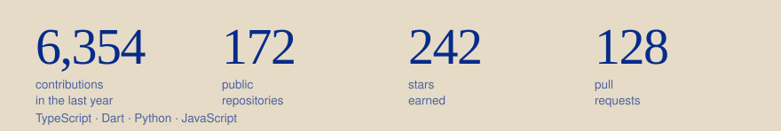

# Praise Masunga

**Software engineer in Chinhoyi, Zimbabwe.** I build web, mobile, and AI products for universities, clinics, water services, and small businesses.

<picture>
  <source media="(prefers-color-scheme: dark)" srcset="assets/signals-dark.svg">
  <source media="(prefers-color-scheme: light)" srcset="assets/signals-light.svg">
  
</picture>

## Selected work

| Project | What it does | Built with |
| --- | --- | --- |
| **[autopilot-cli](https://github.com/PraiseTechzw/autopilot-cli)** &nbsp;  | Python CLI for bounded, inspectable AI-assisted development. The AI can read your repository; it cannot modify it without an explicit flag. | Python · VS Code |
| **[Taste of Zimbabwe](https://github.com/PraiseTechzw/recipe)** &nbsp;  | Recipe discovery app with saved favourites and step-by-step cooking. Published on Google Play. | Android · Web |
| **[itrack-zimbabwe](https://github.com/PraiseTechzw/itrack-zimbabwe)** &nbsp;  | ERP covering inventory, purchases, sales, accounting, and requisitions for a Zimbabwean distributor. | PHP · MySQL |
| **[borewatch](https://github.com/PraiseTechzw/borewatch)** &nbsp;  | Borehole registration, permit workflow, and field inspection, with a preliminary groundwater-risk screen. | Postgres · TypeScript |
| **[CUT SmartFix](https://github.com/PraiseTechzw/cut-smartfix)** &nbsp;  | Campus maintenance for students, ICT technicians, physical-maintenance staff, security, and administrators. Android and web. | TypeScript |
| **[CUT ICT Helpdesk](https://github.com/PraiseTechzw/CUT-ICT-HELPDESK)** &nbsp;  | Support ticket management for the university's ICT department. | PHP |
| **[Teachfolio](https://github.com/PraiseTechzw/teachfolio)** &nbsp;  | Lesson planning, reflection, and evidence portfolios for teachers. Institution-scoped auth and private storage. | TypeScript · Supabase |
| **[mama-mobile](https://github.com/PraiseTechzw/mama-mobile)** &nbsp;  | Pregnancy guidance for expecting mothers in English, ChiShona, and isiNdebele. | TypeScript |

Also: [Paynow NodeJS SDK](https://github.com/PraiseTechzw/Paynow-NodeJS-SDK) (Zimbabwe's payment gateway), [mamas-shop](https://github.com/PraiseTechzw/mamas-shop) (offline sales, stock, and customer credit), [Lunavo](https://github.com/PraiseTechzw/Lunavo) (student wellness and peer support at CUT).

## Why the work looks like this

Almost every project above runs inside an institution, and that changes the engineering well before it changes the interface.

- **Connectivity is not assumed.** A shop records sales, stock, and customer credit offline, then reconciles when the network returns.
- **English is not the default.** Maternal-health guidance ships in ChiShona and isiNdebele as first languages, not as translations bolted on at the end.
- **Identity is institutional.** Students, technicians, reviewers, and admins see different data, so roles, scoping, and audit trails come before features.
- **Payments run through Paynow,** not Stripe, which means owning the SDK when the existing one falls short.

## Flagship: Autopilot CLI

[Autopilot](https://github.com/PraiseTechzw/autopilot-cli) is where I work out what AI tooling should feel like in a normal developer's terminal. **1.1.0** is the current stable release.

The premise is that an agent should be inspectable and bounded. In practice that means:

- Requests are read-only, with credentials redacted before they leave the machine.
- Commits require `--allow-medium`; high-severity review findings block the workflow outright.
- Deterministic local work comes first: project analysis, test discovery, secret scanning, and Git checkpoints with an append-only flight recorder.
- Providers are adapters, so it runs against OpenRouter, any OpenAI-compatible gateway, or no model at all.

There is a VS Code dashboard alongside the CLI. `pip install` the wheel from the releases page, or [try the web tool](https://autopilot-cli.praisetech.tech/).

## Stack

## How I work

1. Start with the operational problem, not the stack.
2. Ship the smallest version that a real user can finish a real task in.
3. Design for the environment it lands in: the device, the connection, the language, the person using it.
4. Leave a handoff. The next developer should be able to run it, read it, and extend it without asking me.

## Now

- Maintaining Autopilot CLI and its VS Code extension.
- Building institutional software around Chinhoyi University of Technology.
- Open to collaboration on education, health, water, and civic infrastructure.

**[praisetech.tech](https://praisetech.tech)** · **[LinkedIn](https://www.linkedin.com/in/praisemasunga/)** · **[Email](mailto:praisetechzw@gmail.com)**

Chinhoyi, Zimbabwe · <a href="https://praisetechzw.github.io/PraiseTechzw/">Profile site</a> · <a href="templates/README.md">Profile templates</a>

